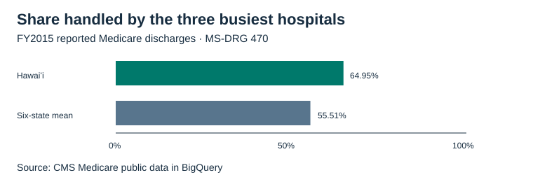

# Findings — Joint replacement discharge concentration

In FY2015, Hawaiʻi's three busiest reporting hospitals handled 606 of 933 reported Medicare discharges for major hip and knee joint replacement and related procedures (MS-DRG 470). Their share was **64.95%**, compared with **55.51%** across six peer states, a **9.44 percentage-point gap**. At Hawaiʻi's reported volume, 606 − (0.55510273 × 933) ≈ **88 discharges** above the benchmark. One source row summarizes one hospital and procedure group.

## Peer benchmark

Use the equally weighted mean for other states with 7–13 reporting hospitals. The range was set before querying, around the 10 hospitals seen in the earlier CMS extract. BigQuery returned 11 Hawaiʻi hospitals. Comparing similarly sized reporting groups limits the mechanical effect of counting the top three out of very different numbers of hospitals.

| State | Reporting hospitals | Top-three discharges | Total discharges | Share |
| --- | ---: | ---: | ---: | ---: |
| Hawaiʻi | 11 | 606 | 933 | 64.95% |
| Alaska | 7 | 567 | 783 | 72.41% |
| Idaho | 13 | 1,261 | 2,751 | 45.84% |
| Montana | 12 | 993 | 2,214 | 44.85% |
| New Hampshire | 13 | 1,359 | 2,770 | 49.06% |
| Rhode Island | 10 | 973 | 1,395 | 69.75% |
| Wyoming | 9 | 334 | 653 | 51.15% |

At the peer share, about 518 of Hawaiʻi's 933 reported discharges would have been at its three busiest hospitals. The difference of about 88 discharges gives a network planner a scale for investigating backup capacity. This historical comparison measures concentration in reported Medicare volume. An assessment of actual spare capacity would need current hospital-level information. CMS suppresses hospital and procedure combinations with 10 or fewer discharges. [CMS documentation](https://data.cms.gov/provider-summary-by-type-of-service/medicare-inpatient-hospitals/medicare-inpatient-hospitals-by-provider-and-service) · [BigQuery job](https://console.cloud.google.com/bigquery?project=dotted-lexicon-509700-t8&ws=!1m5!1m4!1m3!1sdotted-lexicon-509700-t8!2sjob_DCi7jdoLi48Vf761S2josruw4P7L!3sUS)
