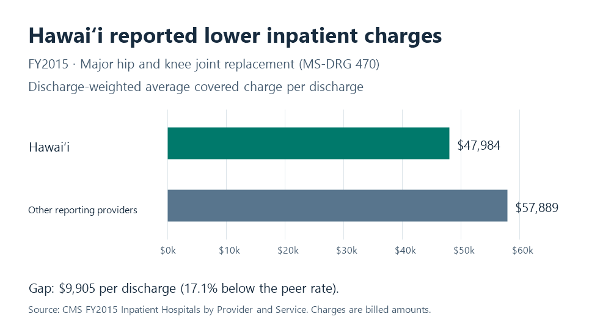

# Findings — FY2015 inpatient charges

## The gap

For major hip and knee joint replacement or reattachment of lower extremity without major complication or comorbidity (MS-DRG 470), Hawaiʻi's discharge-weighted average covered charge was **$47,984.03**, versus **$57,888.71** among other reporting providers. Hawaiʻi was **$9,904.68 per discharge lower (17.1%)**. One source row summarizes one hospital's discharges for one DRG.

| Cohort | Reporting providers | Reported discharges | Covered charge per discharge |
| --- | ---: | ---: | ---: |
| Hawaiʻi | 10 | 914 | $47,984.03 |
| Other reporting providers | 2,672 | 470,849 | $57,888.71 |

## The benchmark

Pool the reported discharges of providers outside Hawaiʻi for the same FY2015 DRG. This is a peer comparison that holds the service classification and year fixed and avoids including Hawaiʻi in its own benchmark. Weight each provider's average charge by its discharges so each reported discharge has equal weight.

## Value

**About $9.05 million in lower billed charges relative to the peer rate:** ($57,888.705583 − $47,984.029540) × 914 ≈ **$9,052,874**. Both unit amounts come from the [CMS FY2015 public release](https://data.cms.gov/sites/default/files/2023-05/81895338-4c5c-4ad7-a490-8e5a9a972825/MUP_IHP_RY23_P03_V10_DY15_PRVSVC.CSV). No external unit price is used. Multiplying published average charges by volume estimates aggregate charges; source averages are rounded. This is a descriptive comparison at fixed volume, not a payment, cost, or savings estimate.

## What the comparison can support

Investigate how the Hawaiʻi providers set charges for this DRG before making any pricing decision. The release omits low-volume hospital/DRG combinations under CMS reporting rules. A same-DRG comparison does not adjust for hospital characteristics, geography, or differences among patients within the DRG. Charges are amounts billed, not amounts paid or costs to deliver care. This historical snapshot does not describe current pricing or establish a cause.

See [query notes](sql/README.md), [source documentation](Other/README.md), and the [charter](charter.md).
